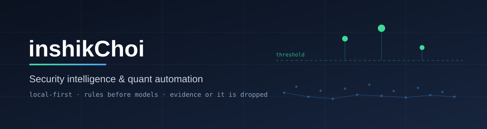

# Hi, I'm inshikChoi 👋

I build small, reliable automation for security intelligence and quantitative research.
Most of my work runs unattended on a single Windows machine, so I care about
failure modes more than features: retries, watchdogs, audit trails, and reports
that say honestly when something was not checked.

## What I work on

- **Security intelligence automation** — scheduled collection, de-duplication,
  rule-based triage, and daily briefings, with local LLMs used only where every
  claim can be checked against its source text.
- **Quantitative research tooling** — backtests, parameter sweeps, and risk checks
  that are reproducible and logged.
- **Malware and data analysis utilities** — small command-line tools for
  triage and statistics.

## How I like to build

- Local-first: data stays on my own hardware; secrets never leave it.
- Plain rules before models; a model's output must cite evidence or it is dropped.

## Stack

Most of my repositories are private. This page is the public summary.
